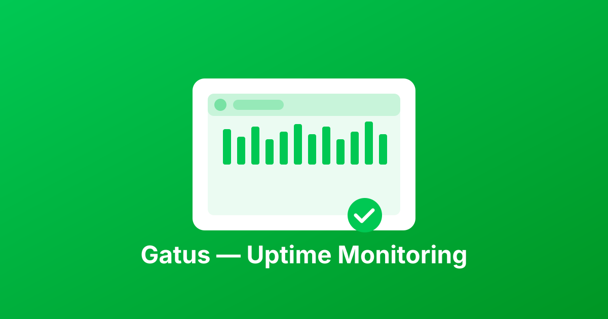

# Deploy and Host

[](https://railway.com/deploy/gatus-1)



Gatus is a beautiful, lightweight uptime monitoring dashboard. Deploy it on Railway in minutes to monitor your endpoints and get instant alerts when something goes down.

## About Hosting

Gatus runs as a single Docker container on port 8080. Railway provides compute, TLS at the edge, and a public URL. All monitoring data (config, status history, metrics) is stored at `/data` — add a Railway Volume there to persist everything across restarts.

## Why Deploy

- **Ultra-lightweight** — Single Go binary, 40-60MB RAM at idle. Safe for any plan.
- **Beautiful UI** — Clean, responsive dashboard with real-time status updates.
- **Comprehensive monitoring** — HTTP, TCP, gRPC, DNS, and more protocol support.
- **Alerting** — Slack, Discord, Telegram, email, webhook, and more notification channels.
- **Response time tracking** — Historical data with latency percentiles and charts.
- **Zero external dependencies** — SQLite embedded, no separate database needed.
- **REST API** — Full `/api/v1` API for programmatic access.
- **Groups & tags** — Organize endpoints by team, project, or environment.

## Common Use Cases

- **Website uptime** — Monitor public-facing sites and APIs from multiple locations.
- **Service health checks** — Track microservices, databases, and internal tools.
- **Status page** — Public or private status pages for your users.
- **SLA tracking** — Measure uptime percentage over time with historical data.
- **Incident detection** — Get notified before your users notice.
- **Multi-region monitoring** — Deploy multiple instances to check from different locations.

## Dependencies for Gatus

### Deployment Dependencies

- **Volume (required)** — A Railway Volume must be mounted at `/data`. Gatus stores its YAML configuration, SQLite database, and status history there. Without it, all monitoring data is lost on every restart.
- **No external services** — Gatus embeds SQLite and has no companion database, cache, or queue dependency. A single service with one volume is the complete deployment.
- **Outbound network access** — Gatus needs egress to reach the endpoints it monitors and to send alerts (Slack, Discord, email, webhooks). Railway provides this by default.

## Configuration

Gatus is configured via a YAML config file at `/data/config.yaml`. On first launch, Gatus auto-generates a default config with sensible defaults. You can edit the config through the web UI or by editing the file directly.

### Key Options

| Option | Description |
|--------|-------------|
| `port` | HTTP listen port (default: 8080, matches Railway PORT) |
| `endpoints` | List of endpoints to monitor |
| `alerts` | Notification channel configurations |
| `storage` | SQLite database path (default: `/data/gatus.db`) |
| `web` | Web UI configuration |

### Example Config

```yaml
endpoints:
  - name: Google
    url: https://www.google.com
    interval: 5m
    conditions:
      - "[STATUS] == 200"
      - "[RESPONSE_TIME] < 1000"
  - name: API
    url: https://api.example.com/health
    interval: 30s
    conditions:
      - "[STATUS] == 200"
```

## FAQ

### How do I add endpoints?

Open the Gatus web UI and navigate to the Configuration page. You can add, edit, and delete endpoints there. Alternatively, edit `/data/config.yaml` directly and restart the service.

### How do I set up alerts?

In the config file, add an `alerts` section with your notification channel. For example, for Slack:

```yaml
alerts:
  - type: slack
    webhook-url: https://hooks.slack.com/services/...
```

### Where is my data stored?

All data (config, SQLite database, status history) is stored at `/data`. The Railway Volume mount ensures data persists across restarts.

### What happens if the volume isn't mounted?

Without a volume, all monitoring data and configuration will be lost on every restart. The volume is required for proper operation.

### How do I monitor my own Railway deployment?

Gatus can monitor any HTTP endpoint, including your Railway apps. Add your app's `*.up.railway.app` URL as an endpoint with a health condition.

### Is there a public API?

Yes. Gatus exposes a REST API at `/api/v1/` with endpoints for checking status, managing configs, and more. Full documentation is available in the web UI.
